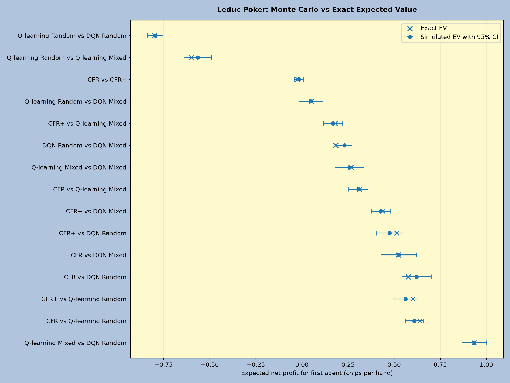

# Poker AI Research

Exploring game theory, reinforcement learning and decision making under uncertainty through poker.

> Personal Project<br>
> Date: 10/2026<br>
> [**Live Streamlit app**](https://poker0ai.streamlit.app/)

## Project overview

Poker is an interesting problem for artificial intelligence because making the best decision is not simply a matter of having the strongest hand. Players must make decisions with incomplete information, account for what their opponent might do and balance the value of aggressive play against the risk of losing.

This project explores how different algorithms approach these decisions.

The project implements two simplified poker games, Kuhn Poker and Leduc Poker, and compares four learning methods:

- Counterfactual Regret Minimisation (CFR)
- Counterfactual Regret Minimisation Plus (CFR+)
- Q learning
- Deep Q Networks (DQN)

We investigate how well these algorithms learn to play poker, whether they develop strategies close to Nash equilibrium and how profitability against weaker opponents compares with strategic robustness.

Alongside the learning algorithms, we developed an evaluation framework to calculate expected profit, exploitability and performance against other agents. This project also comes with an interactive application where users can play against the trained strategies and explore the results.

## The poker games

### Kuhn Poker

Kuhn Poker is one of the simplest games that captures the main challenges of poker. Despite having very few possible decisions, it involves bluffing, uncertainty and strategic reasoning.

The game uses three cards: Jack, Queen and King.

**Rules**

1. Two players each contribute an ante of 1 chip.
2. Each player receives one private card. The remaining card is discarded.
3. Player 0 acts first and can check or bet 1 chip.
4. If the first player checks, the second player can check or bet.
5. A player facing a bet can call or fold.
6. If neither player folds, the player with the higher card wins.
7. If somebody folds, their opponent wins the pot.

Net profit is 1 chip when both players check or someone folds, and 2 chips when a bet is called.

Kuhn Poker has **12 information sets**. An information set represents everything the player knows when making a decision, consisting of their private card and the betting history.

For example, holding a King after the opponent has checked is a different situation from holding a Jack after the same sequence.

Kuhn Poker is particularly useful because its small game tree can be evaluated exactly, and we can compare learned strategies against a known Nash equilibrium.

### Leduc Poker

Leduc Poker introduces additional complexity while remaining small enough for exact evaluation.

It uses six cards: 2x Jacks, 2x Queens and 2x Kings.

Each player receives one private card, and a third card becomes a shared public card after the first betting round.

**Rules**

1. Both players contribute an ante of 1 chip.
2. Each player receives one private card.
3. The first betting round begins, with a bet size of 2 chips.
4. Players may check, bet, call, fold or raise depending on the situation.
5. Once the first betting round finishes, the public card is revealed.
6. A second betting round begins, with a bet size of 4 chips.
7. A maximum of one raise is permitted in each betting round.
8. If neither player folds, the hand reaches showdown.

**Hand rankings**

A player forms a pair when their private card matches the public card. A pair always beats a hand without a pair.

If neither player has a pair, the higher private card wins. Equal hand strengths result in a split pot.

For example, a Jack with a public Jack beats a King with that same public Jack because a pair of Jacks beats King high.

Leduc has **288 information sets** in this implementation, compared with Kuhn's 12.

The additional betting round, public card and ability to raise make Leduc a more challenging environment for training and evaluating agents.

## Nash equilibrium and exploitability

A Nash equilibrium is a collection of strategies where neither player can improve their expected payoff by changing their own strategy while their opponent keeps theirs unchanged. In a two player zero sum game, a Nash equilibrium guarantees that neither player can gain an advantage by exploiting the other's strategy.

Importantly, playing an equilibrium strategy does not mean winning every hand or earning the most money against every possible opponent. Instead, it means making decisions that cannot be exploited to produce an advantage against you.

### Why randomisation matters

A strong poker strategy often requires mixing different actions.

Suppose an agent always bets when holding a strong card and always checks when holding a weak card. Its opponent could eventually recognise this pattern and respond accordingly.

An equilibrium strategy may deliberately bluff with weak cards some of the time, making its betting behaviour less predictable. This means an optimal strategy is not always a single action. It can be a probability distribution over several possible actions.

### Exploitability

To measure how close a strategy is to equilibrium, we use **exploitability**. Exploitability measures how much an optimal opponent can gain by responding to a fixed strategy, averaged across the two player positions.

A Nash equilibrium has zero exploitability in a two player zero sum game. This distinction is important because an agent can be highly profitable against weak opponents while remaining vulnerable against stronger ones.

## Learning algorithms

### Counterfactual Regret Minimisation (CFR)

CFR is an algorithm designed to learn strategies in games where players do not have access to all the information. Rather than learning exclusively from individual hands, CFR explores the game tree and evaluates the possible decisions that players could make.

The underlying idea is **regret**. Regret measures how much better an alternative action would have performed compared with the current strategy. By repeatedly calculating and accumulating regret, the algorithm learns which actions deserve higher probabilities.

#### Calculating the value of a decision

Let $I$ represent an information set and $A(I)$ the set of actions available in that situation. The agent follows a strategy $\sigma(I,a)$, which gives the probability of choosing action $a$. The expected value of the current strategy is

$$
V_i(I)=\sum_{a\in A(I)}\sigma(I,a)V_i(I,a)
$$

where $V_i(I,a)$ represents the expected payoff to player $i$ from choosing action $a$ and following the current strategy afterwards.

For example, suppose the agent can check or bet:

| Action | Expected payoff | Current probability |
|---|---:|---:|
| Check | 1 chip | 50% |
| Bet | 3 chips | 50% |

The expected value of the current strategy is

$$
V_i(I)=0.5(1)+0.5(3)=2
$$

Betting has a higher expected payoff than the current strategy, while checking has a lower expected payoff.

The corresponding action value differences are

$$
r(I,\text{check})=1-2=-1
$$

$$
r(I,\text{bet})=3-2=+1
$$

These are the local regret differences before accounting for how likely the relevant game states are to be reached.

#### Counterfactual regret

In poker, several different underlying game states can belong to the same information set because the player cannot see their opponent's cards. CFR must therefore calculate regret across all the hidden states that could produce the same information. The counterfactual regret increment is

$$
r_i^t(I,a)=
\sum_{h\in I}
\pi_c(h)\pi_{-i}^{\sigma^t}(h)
\left[v_i^{\sigma^t}(h,a)-v_i^{\sigma^t}(h)\right]
$$

Here:

- $t$ is the current training iteration.
- $h$ is a possible game history belonging to information set $I$.
- $\pi_c(h)$ is the probability of the relevant card deal.
- $\pi_{-i}^{\sigma^t}(h)$ is the probability of the opponent's earlier actions under the current strategy.
- $v_i^{\sigma^t}(h,a)$ is the expected payoff from choosing action $a$.
- $v_i^{\sigma^t}(h)$ is the expected payoff from following the current strategy.

An important detail is that the weighting excludes the probability of the player's own earlier actions.

This is what makes the regret *counterfactual*. We evaluate how useful an alternative decision would have been, even in situations the player might rarely reach under its current strategy.

#### Accumulating regret

CFR does not change its strategy based on a single regret calculation. Instead, it accumulates regret across training iterations:

$$
R_i^T(I,a)=\sum_{t=1}^{T}r_i^t(I,a)
$$

If an action repeatedly performs better than the current strategy, its cumulative regret increases. If it consistently performs worse, its cumulative regret can become negative.

#### Regret matching

The algorithm uses the accumulated regrets to calculate the next action probabilities. The update is:

$$
\sigma^{T+1}(I,a)=
\begin{cases}
\displaystyle \frac{\max(R_i^T(I,a),0)}
{\sum_{b\in A(I)}\max(R_i^T(I,b),0)}, &
\text{if the denominator is positive}\\[10pt]
\displaystyle \frac{1}{|A(I)|}, & \text{otherwise}
\end{cases}
$$

This means that actions with larger positive regrets receive higher probabilities.

Negative regrets are treated as zero when determining the strategy. If no action has positive regret, all legal actions receive equal probability. For example, suppose the accumulated regrets are:

| Action | Cumulative regret |
|---|---:|
| Check | 2 |
| Bet | 6 |

Regret matching assigns

$$
P(\text{check})=\frac{2}{2+6}=0.25
$$

$$
P(\text{bet})=\frac{6}{2+6}=0.75
$$

The agent is now more likely to bet, but checking remains possible. This ability to mix actions is particularly important in poker, where always selecting the same action can make a strategy predictable.

#### Learning the average strategy

The final step is to construct the average strategy across training. Rather than using only the action probabilities from the final iteration, CFR accumulates the strategies encountered during training. The average strategy can be written as

$$
\overline{\sigma}^{T}(I,a)=
\frac{\sum_{t=1}^{T}\rho_{i,t}(I)\sigma^t(I,a)}
{\sum_{t=1}^{T}\rho_{i,t}(I)}
$$

Here $\rho_{i,t}(I)$ is the relevant averaging weight, accounting for the probability of the card deal and the player's own earlier actions. In the implementation, these weights are accumulated over the underlying game histories.

Averaging is important because the strategy from one individual iteration can fluctuate, while the average strategy is the quantity for which CFR provides its useful convergence guarantees.

#### How CFR makes decisions

Once training is complete, the agent stores the average strategy as a probability distribution for every information set. During gameplay, it identifies the current information set, retrieves the corresponding action probabilities and randomly samples a legal action according to those probabilities. It does not need to explore the game tree again during play.

### Counterfactual Regret Minimisation Plus (CFR+)

CFR+ builds on CFR by changing how cumulative regrets are updated and how strategies are averaged. It uses the same general idea of learning from the outcomes of alternative decisions, but makes several modifications that can improve convergence.

#### Clipping cumulative regrets

In ordinary CFR, the cumulative regret is

$$
R_i^t(I,a)=R_i^{t-1}(I,a)+r_i^t(I,a)
$$

CFR+ instead uses

$$
R_i^{+,t}(I,a)=\max\left(0,\,R_i^{+,t-1}(I,a)+r_i^t(I,a)\right)
$$

The difference is that CFR+ never stores negative cumulative regret. Suppose an action has cumulative regret of $2$, followed by a regret increment of $-5$.

Ordinary CFR produces

$$
R_{\text{CFR}}=2-5=-3
$$

CFR+ instead produces

$$
R_{\text{CFR+}}=\max(0,2-5)=0
$$

This matters because an action with negative accumulated regret in ordinary CFR must first overcome that negative balance before its positive regret can influence future decisions. CFR+ removes this negative balance after every update. It still uses regret matching to turn the resulting cumulative regrets into action probabilities.

#### Alternating player updates

My CFR implementation updates both players' cumulative regrets after evaluating the game tree using the same iteration strategy. CFR+ instead updates the players separately. It first calculates and applies the regret updates for player 0. It then calculates player 1's regrets using the updated strategy of player 0. This allows the second player's update to respond to the most recent changes in the first player's strategy.

#### Linear strategy averaging

CFR+ also changes how it calculates the final average strategy. Ordinary CFR gives each iteration equal importance before adjusting for reach probabilities. CFR+ assigns larger weights to later iterations:

$$
w_t=\max(0,t-d)
$$

where $d$ is an optional averaging delay.

The resulting average strategy is

$$
\overline{\sigma}_+^T(I,a)=
\frac{\sum_{t=1}^{T}w_t\,\rho_{i,t}(I)\,\sigma^t(I,a)}
{\sum_{t=1}^{T}w_t\,\rho_{i,t}(I)}
$$

When $d=0$, iteration 1 receives weight 1, iteration 2 receives weight 2 and so on.

This gives the later strategies more influence over the final policy.

When an averaging delay is used, earlier iterations can receive zero weight. I also experimented with the effect of different averaging delays in Kuhn Poker.

#### How CFR+ makes decisions

CFR+ ultimately behaves in the same way as CFR during gameplay. It retrieves the learned average strategy for the current information set and samples an action using the stored probabilities. The important difference is how those probabilities were obtained. By combining nonnegative cumulative regrets, alternating updates and weighted averaging, CFR+ can approach equilibrium more efficiently in terms of training iterations.

In these experiments, CFR+ achieved substantially lower exploitability than ordinary CFR at the same iteration count, although each CFR+ iteration was also more computationally expensive.

### Q learning

Q learning approaches poker differently. Rather than exploring the full game tree and minimising regret, it learns through experience by playing hands and observing the resulting rewards. The agent maintains a table of **Q values**, which estimate the expected future reward from taking an action in a particular information set.

#### How Q learning works

At each decision, the agent chooses between exploring a random legal action and exploiting the highest estimated Q value. This is called epsilon greedy exploration. After observing the outcome, it updates the relevant Q value:

$$
Q_{\text{new}}(s,a)=Q(s,a)+\alpha\left[r+\gamma\max_{a'}Q(s',a')-Q(s,a)\right]
$$

Here $\alpha$ is the learning rate, $r$ is the observed reward and $\gamma$ controls the importance of future rewards. We use the final net profit or loss of a completed hand as the terminal reward. During training, the agent gradually updates its action values based on the decisions it makes and the outcomes it experiences. We also experimented with different opponents and learning schedules, including reducing the learning rate as training progresses.

#### How Q learning makes decisions

After training, exploration is removed. The agent selects the legal action with the highest learned Q value. If multiple actions share the maximum value, the saved policy assigns them equal probability. Unlike CFR, Q learning is not specifically designed to find equilibrium strategies. It can become very effective against particular opponents without necessarily learning behaviour that is robust against stronger strategies.

### Deep Q Networks (DQN)

Deep Q Networks extend Q learning by replacing the Q table with a neural network. Instead of separately storing every action value, the network learns to estimate Q values from numerical representations of the information available to the player.

#### Representing the game

Each information set is converted into a numerical input vector.

For Kuhn Poker, the network uses 7 input features representing the private card and betting history.

For Leduc, it uses 55 input features representing the private card, public card and betting actions.

The networks use two hidden layers with 32 neurons each and ReLU activation functions.

Their outputs estimate the Q values of the possible actions.

#### How DQN learns

The agent plays hands and stores its experiences in replay memory. During training, it samples batches of previous experiences and updates the network to reduce the difference between predicted Q values and target values. The project uses two techniques to improve learning stability.

**Experience replay** allows the network to learn from previous decisions rather than relying only on the most recent experiences.

**A target network** provides a more stable estimate of future rewards. Its parameters are periodically updated from the main network.

We experiment with both Huber loss and mean squared error loss, alongside different training opponents.

#### How DQN makes decisions

During training, DQN uses epsilon greedy exploration. Otherwise, it passes the current information set through the network, predicts the values of the available actions and selects the legal action with the highest Q value. After training, the learned greedy strategies are saved as JSON files.

The web application uses these saved policies, which means users can play against the trained DQN agents without running the neural networks again.

## Evaluation and findings

We also evaluate the algorithms using exact expected value calculations, exploitability measurements, direct matches against other agents and Monte Carlo simulations. Exact evaluation considers the possible card deals and action branches, allowing me to compare fixed strategies without sampling error.

Exploitability measures how profitable an optimal response would be against an agent, while direct matchups show how well different learned strategies perform against each other.

### Leduc results

| Agent | EV vs Random | EV vs CFR+ | Exploitability |
|---|---:|---:|---:|
| CFR | +0.821 | −0.023 | 0.098 |
| CFR+ | +0.718 | 0.000 | **0.005** |
| Q learning Random | +2.112 | −0.602 | 3.383 |
| Q learning Mixed | +1.531 | −0.180 | 2.333 |
| DQN Random | **+2.224** | −0.514 | 3.283 |
| DQN Mixed | +2.019 | −0.438 | 2.767 |

All expected values are measured in net chips per hand, with both player positions weighted equally.

### Main findings

**CFR+ produced the most robust strategy.** It achieved much lower exploitability than the other agents, making it the closest to equilibrium in this comparison.

**DQN Random was the most profitable against Random.** However, it lost money against CFR+, showing that exploiting a weak opponent does not necessarily translate into stronger overall performance.

**Q learning Mixed performed relatively well among the reinforcement learning agents.** It had the lowest exploitability of the four RL policies and performed better against CFR+ than the other RL agents.

Ordinary CFR also achieved a higher average expected profit against the selected tournament opponents than CFR+, despite being more exploitable. This shows that tournament profitability and robustness measure different properties.

### Monte Carlo validation

We also simulate 20 independent sessions of 1,000 hands for each of the 15 unique Leduc matchups, giving **300,000 simulated hands** in total.

These simulations are used to investigate how closely realised profits matched the exact expected values and how much variation remained between sessions.



The exact EV fell inside the simulated 95% confidence interval for 14 of the 15 matchups.

The simulations broadly supported the exact calculations, while also showing why a small true advantage can be difficult to identify from a limited number of hands.

## Tools used

- **Python** for the game engines, training algorithms and evaluation
- **NumPy** for numerical calculations
- **PyTorch** for the DQN agents
- **Matplotlib** for experimental visualisations
- **Streamlit** for the interactive web application
- **pytest** for automated testing

## Repository contents

| Location | Contents |
|---|---|
| `poker_ai/games/` | Kuhn and Leduc game rules |
| `poker_ai/algorithms/` | CFR, CFR+, Q learning and DQN implementations |
| `poker_ai/agents/` | Agents and saved strategy loading |
| `poker_ai/evaluation/` | Exact expected values, exploitability and match evaluation |
| `poker_ai/experiments/` | Training and comparison experiments |
| `models/` | Saved trained strategies and model checkpoints |
| `results/` | Experiment results, tables and figures |
| `tests/` | Automated tests |
| `app.py` | Streamlit application |

## Scope and limitations

These findings are specific to the saved trained policies and experimental settings. Repeating training across more independent seeds would be necessary for stronger conclusions about the algorithms in general.

## Streamlit app

The web application lets users play against the trained strategies and explore the experimental results.

**[Play PokerAI](https://poker0ai.streamlit.app/)**

To run the application locally:

```bash
python -m pip install -r requirements.txt
python -m streamlit run app.py
```
